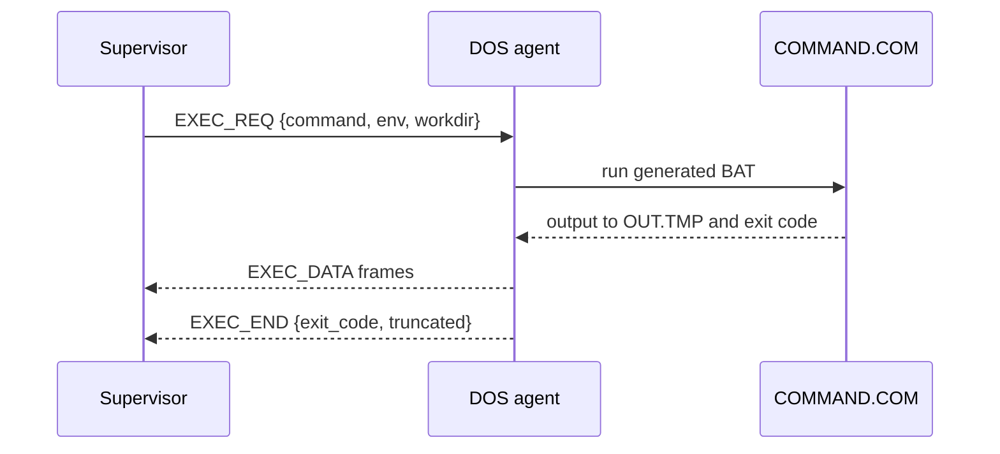

# DOSker Agent Protocol Contract

Version 1. This document defines the serial protocol between the supervisor and the 16-bit DOS agent.

## Transport

- Serial port COM2 by default. The control port is a `MACHINE` setting.
- 8 data bits, no parity, 1 stop bit, no hardware flow control.
- Default speed 115200 baud. The speed is a `MACHINE` setting.
- The link carries one session at a time.
- There is no authentication. The link is local to the VM. The host must keep the socket private.

## Agent Configuration

Before boot, the supervisor writes `C:\DOSKER\CONFIG.INI` into the private writable disk. The build engine writes it into the build image before a build VM starts.

```ini
CONTROL_PORT=2
BAUD=115200
```

- The agent reads the file at startup.
- If the file is missing or a key is absent, the agent uses COM2 and 115200.
- The file is not part of the image. It is host-written configuration.
- A booter image has no agent and no configuration file.

## Frame Format

All multi-byte integers are big-endian.

```
offset  size  field
0       4     magic "DKR1"
4       1     version (1)
5       1     type
6       1     flags (0)
7       1     reserved (0)
8       4     request_id
12      4     sequence
16      4     payload_length (0..4096)
20      N     payload
20+N    4     crc32
```

- `crc32` is the IEEE CRC-32 over bytes 0 through `20+N-1`.
- Maximum payload is 4096 bytes.
- The version 1 header has no session field. The serial link is the session boundary. The agent stores the `session_id` from `HELLO_ACK` only for guest-reboot detection and host bookkeeping.
- The sender uses stop-and-wait. It sends one frame, waits for an ACK, and then sends the next.
- The receiver sends `ACK` with the same `request_id` and `sequence` after a valid frame.
- On a CRC error, the receiver sends `NAK` with the same `request_id` and `sequence`.
- The sender retries three times after a timeout of 500 ms. After the third failure it closes the session.
- A frame with an unknown type gets `ERROR` with code `UNSUPPORTED`.

## Frame Types

| Value | Name | Direction | Payload |
| --- | --- | --- | --- |
| 0x01 | `HELLO` | agent to host | JSON |
| 0x02 | `HELLO_ACK` | host to agent | JSON |
| 0x03 | `ACK` | both | none |
| 0x04 | `NAK` | both | none |
| 0x10 | `EXEC_REQ` | host to agent | JSON |
| 0x11 | `EXEC_DATA` | agent to host | raw bytes |
| 0x12 | `EXEC_END` | agent to host | JSON |
| 0x20 | `PUT_REQ` | host to agent | JSON |
| 0x21 | `PUT_DATA` | host to agent | raw bytes |
| 0x22 | `PUT_END` | agent to host | JSON |
| 0x23 | `GET_REQ` | host to agent | JSON |
| 0x24 | `GET_DATA` | agent to host | raw bytes |
| 0x25 | `GET_END` | agent to host | JSON |
| 0x26 | `STAT_REQ` | host to agent | JSON |
| 0x27 | `STAT_RESP` | agent to host | JSON |
| 0x30 | `PING` | host to agent | none |
| 0x31 | `PONG` | agent to host | JSON |
| 0x40 | `SHUTDOWN` | host to agent | JSON |
| 0x41 | `SHUTDOWN_ACK` | agent to host | JSON |
| 0x7F | `ERROR` | both | JSON |

## Handshake

1. The host creates the serial socket before it starts the engine.
2. The agent starts from `AUTOEXEC.BAT` and sends `HELLO` with a new `request_id`.
3. The agent repeats `HELLO` every second until it receives `HELLO_ACK`, for at most 10 seconds.
4. If the host starts after the agent, it sends `PING` with a new `request_id`. An agent that has not completed the handshake answers with `HELLO`.
5. The host completes the handshake with `HELLO_ACK`.
6. A second `HELLO` after a session is established means the guest rebooted. The supervisor fails the active command with `guest_rebooted`.

`HELLO` payload:

```json
{
  "protocol_version": 1,
  "agent_version": "1.0.0",
  "dos": "FreeDOS 1.3",
  "memory_kb": 640,
  "control_port": 2,
  "max_payload": 4096,
  "features": ["exec", "put", "get", "stat"]
}
```

The host rejects a `protocol_version` it does not support and stops the container with a clear error. The image config and the lock file record the agent version.

`HELLO_ACK` payload:

```json
{ "session_id": "b1f0c2" }
```

The agent stores the session ID for guest-reboot detection and host bookkeeping. It does not validate individual frames against a session ID. The serial link is the session boundary.

## Command Execution

Sequence:



`EXEC_REQ` payload:

```json
{
  "command": "TEST.EXE",
  "env": { "PATH": "C:\\APP;C:\\DOS" },
  "workdir": "C:\\APP",
  "max_output_bytes": 1048576
}
```

Rules:

- The agent locates the command interpreter through `COMSPEC`. If `COMSPEC` is unset, it uses `C:\COMMAND.COM`.
- The agent writes `C:\DOSKER\RUN.BAT` with `@ECHO OFF`, the `SET` lines, the `CD` line, and the command with output redirected to `C:\DOSKER\OUT.TMP`.
- The agent runs the batch through `COMMAND.COM` and reads the return code with INT 21h/AH=4Dh.
- The agent streams `OUT.TMP` in `EXEC_DATA` frames of at most 4096 bytes. It deletes `RUN.BAT` and `OUT.TMP` after the result is sent.
- If the output exceeds `max_output_bytes`, the agent stops at the limit and sets `truncated` to true.
- `EXEC_END` payload:

```json
{
  "exit_code": 0,
  "output_bytes": 12,
  "truncated": false,
  "duration_ms": 340
}
```

- The host enforces the timeout. The agent cannot cancel a running child. On a host timeout, the supervisor kills the engine.
- A second `EXEC_REQ` while a command runs gets `ERROR` with code `BUSY`.
- A command that writes directly to video produces no text. `output_bytes` is 0 and the host records that fact.
- The DOS command line is limited to 127 characters. A longer command gets `ERROR` with code `TOO_LONG`.
- The agent sets `command_not_found` to true only when the captured output matches a known English message from FreeDOS or MS-DOS. This is best effort and is documented as such.

## File Transfer

### PUT

1. Host sends `PUT_REQ` with `{ "path": "C:\\APP\\DATA.BIN", "size": 12345, "overwrite": true }`.
2. Agent checks the path and the free space. It replies with `ERROR` or with `ACK`.
3. Host sends `PUT_DATA` frames with raw bytes.
4. Agent writes the bytes to a temporary file and renames it on success.
5. Agent sends `PUT_END` with `{ "ok": true, "bytes": 12345 }`.

### GET

1. Host sends `GET_REQ` with `{ "path": "C:\\APP\\OUT.BIN" }`.
2. Agent checks the file and sends `ERROR` or starts `GET_DATA` frames.
3. Agent sends `GET_END` with `{ "ok": true, "size": 12345 }`.

### STAT

`STAT_REQ` with `{ "path": "C:\\APP\\APP.EXE" }`. `STAT_RESP` with:

```json
{
  "exists": true,
  "size": 12345,
  "directory": false,
  "attributes": { "read_only": false, "hidden": false, "system": false, "archive": true },
  "timestamp": "1996-03-14T12:00:00Z"
}
```

- `directory` is true for a directory and false for a file. A directory reports `size` 0.
- The four `attributes` fields are independent of `directory`. There is no directory attribute.
- A missing path reports `exists` false, `size` 0, `directory` false, all four attributes false, and no `timestamp` field.

## Liveness

- `PING` gets `PONG` with `{ "agent_version": "1.0.0", "busy": false }`.
- The supervisor sends `PING` every 30 seconds when the container is idle.
- Three missed `PONG` replies mark the container unresponsive.

## Shutdown

1. Host sends `SHUTDOWN` with `{ "grace_ms": 10000 }`.
2. Agent closes open files, flushes its temporary files, and sends `SHUTDOWN_ACK` with `{ "ready": true }`.
3. The supervisor stops the engine through its control channel.
4. If the agent does not answer within the grace period, the supervisor kills the engine.
5. The container is marked `dirty=true` when the engine is killed instead of quit.

## Errors

`ERROR` payload:

```json
{
  "code": "BUSY",
  "message": "a command is already running",
  "request_id": 17
}
```

Codes:

| Code | Meaning |
| --- | --- |
| `BUSY` | Another command is running |
| `NO_FILE` | Path does not exist |
| `NO_SPACE` | Not enough free space |
| `BAD_PATH` | Path is invalid or not 8.3 |
| `TOO_LONG` | Command or path exceeds the DOS limit |
| `TOO_LARGE` | File exceeds the transfer limit |
| `UNSUPPORTED` | Unknown type or feature |
| `CRC` | Frame failed CRC after retries |
| `SESSION` | Session is closed or not established |
| `INTERNAL` | Agent internal error |

## Limits

- Maximum payload: 4096 bytes.
- Maximum captured output per command: 1 MiB by default.
- Maximum file size for a single PUT or GET: 16 MiB by default. Larger files should use a volume or a stopped container.
- Maximum command line: 127 characters.
- Maximum open file handles: the agent uses one at a time.
- No compression in version 1.

## Versioning

The version is in every frame. A version mismatch is an error at handshake. New frame types are ignored with `UNSUPPORTED` by an older agent. A breaking change increments the version.
