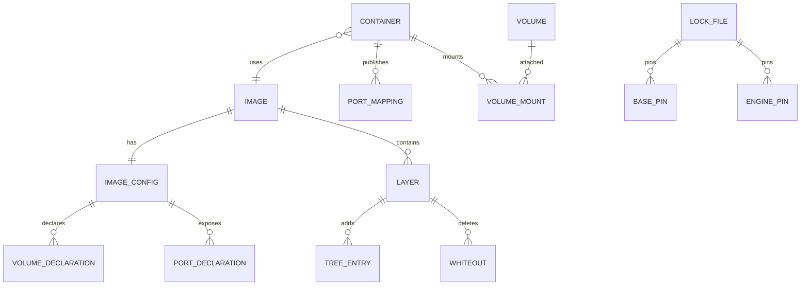
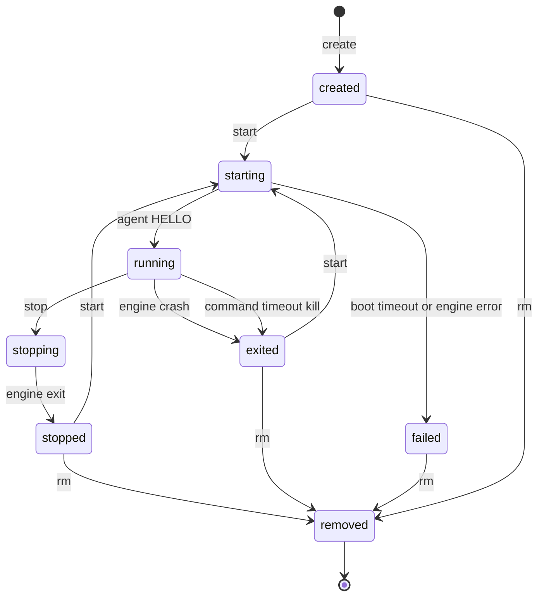
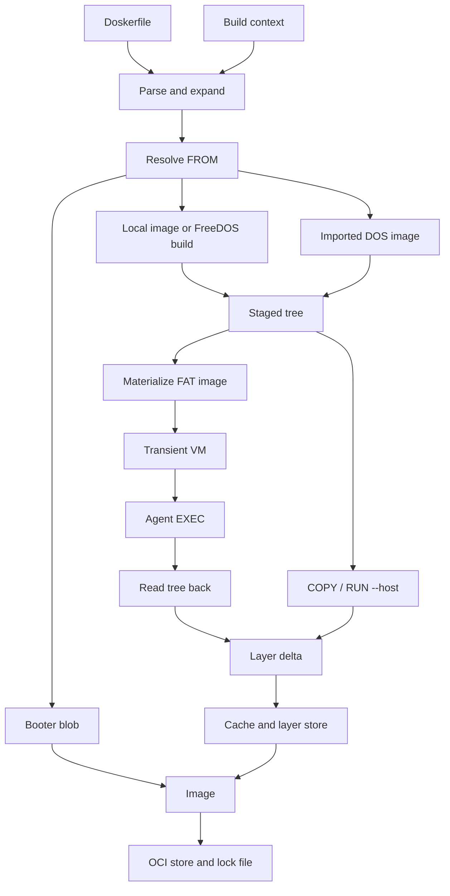
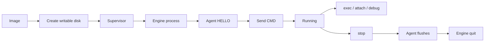

# DOSker — Data Model

This document defines the entities, the on-disk formats, the validation rules, and the container lifecycle. It is the reference for `writing-plans`.

## Entity Overview



## Image

An image is an OCI manifest plus a config plus ordered layers.

| Field | Type | Notes |
| --- | --- | --- |
| `name` | string | Local tag name, for example `demo:latest` |
| `digest` | string | `sha256:<hex>` of the manifest |
| `config_digest` | string | `sha256:<hex>` of the config blob |
| `layers` | list of digests | Ordered, oldest first |
| `created_at` | RFC 3339 | Informational |
| `annotations` | map | OCI annotations, including the source Doskerfile digest |

### Image Config

| Field | Type | Notes |
| --- | --- | --- |
| `schema_version` | integer | `1` |
| `dos_flavour` | enum | `freedos`, `msdos`, `drdos`, `other`, `none` |
| `booter` | boolean | True for an opaque booter image |
| `boot` | `BootMetadata` | Required when `booter` is false |
| `machine` | `MachineProfile` | Effective machine settings |
| `env` | map of string to string | DOS environment variables |
| `workdir` | string | DOS path, for example `C:\APP` |
| `cmd` | string or null | Startup command |
| `exposed_ports` | list of `PortDeclaration` | Guest TCP ports |
| `volumes` | list of `VolumeDeclaration` | Drive letters |
| `engine_pin` | string or null | From `ENGINE` |
| `requires` | list of strings | Capability names |
| `agent_version` | string or null | Agent that built the image. Null for a booter. |
| `created_by` | string | Last instruction |
| `history` | list of `HistoryEntry` | OCI history entries for filesystem and config-only instructions |

`HistoryEntry`:

| Field | Type | Notes |
| --- | --- | --- |
| `created_by` | string | Normalized instruction |
| `created_at` | RFC 3339 | |
| `empty_layer` | boolean | True for config-only instructions |
| `comment` | string or null | Optional |

`PortDeclaration`:

| Field | Type | Notes |
| --- | --- | --- |
| `port` | integer | 1..65535 |
| `protocol` | enum | `tcp` |

`VolumeDeclaration`:

| Field | Type | Notes |
| --- | --- | --- |
| `drive` | string | Single letter with colon, for example `D:` |

### BootMetadata

| Field | Type | Notes |
| --- | --- | --- |
| `layout` | enum | `mbr_partitioned`, `superfloppy`, `opaque` |
| `disk_size` | integer | Bytes |
| `geometry` | object | `cylinders`, `heads`, `sectors`, `sector_size` |
| `partition_start` | integer | LBA, required for `mbr_partitioned` |
| `partition_sectors` | integer | Required for `mbr_partitioned` |
| `mbr` | blob reference | SHA-256 and optional bytes |
| `boot_sector` | blob reference | SHA-256 and optional bytes |
| `fat_type` | enum | `fat12`, `fat16`, `fat32` |
| `volume_label` | string | Up to 11 characters |
| `media_descriptor` | integer | FAT media byte |

A blob reference is `{ "sha256": "...", "bytes_inline": "base64 or null" }`. Small boot sectors are stored inline. Large MBR images are stored as blobs.

### Layer

A normal image layer is an OCI tar blob with two logical parts.

```
dosker-layer.json
files/<DOS path>
```

A booter image has one blob with media type `application/vnd.dosker.booter.v1.raw`. It is the raw disk image, not a tar. It has `booter=true` and no tree.

`dosker-layer.json`:

| Field | Type | Notes |
| --- | --- | --- |
| `schema_version` | integer | `1` |
| `parent` | string or null | Parent layer digest |
| `created_by` | string | Normalized instruction |
| `whiteouts` | list of strings | DOS paths to delete |
| `entries` | list of `TreeEntry` | Metadata for files in the tar |
| `boot` | `BootMetadata` or null | Boot metadata override after a `RUN` |

`TreeEntry`:

| Field | Type | Notes |
| --- | --- | --- |
| `path` | string | Uppercase 8.3 components, `/` separators |
| `kind` | enum | `file`, `dir` |
| `attributes` | object | `read_only`, `hidden`, `system`, `archive` |
| `timestamp` | RFC 3339 | Fixed for `COPY` and `RUN --host` |
| `size` | integer | Bytes |
| `content` | string | Tar member path, for files |

The layer digest is the SHA-256 of the canonical tar. The canonical tar writes members in path order, uses the stored timestamps, and writes `dosker-layer.json` first. The digest covers the tree entries and any `boot` override.

The effective boot metadata is the last non-null `boot` in layer order, or the image config's `boot` when no layer overrides it.

### Tree

The tree is the result of applying layers in order.

- Start empty.
- For each layer, apply whiteouts first, then add or replace entries.
- A later layer can change attributes or content.
- A whiteout for a missing path is ignored.
- A path conflict between a file and a directory is an error.
- Paths are normalized to uppercase 8.3 before application.

The tree always represents `C:\`. Drive letters for volumes are runtime attachments, not layer paths.

## Container

| Field | Type | Notes |
| --- | --- | --- |
| `id` | string | 12 lowercase hex characters |
| `name` | string | Unique, `[a-z0-9][a-z0-9_.-]{0,62}` |
| `image_digest` | string | Image manifest digest |
| `engine` | string | `qemu`, `dosbox-x`, `bochs` |
| `engine_version` | string | Actual binary version |
| `status` | enum | See the lifecycle state machine |
| `pid` | integer or null | Supervisor PID |
| `engine_pid` | integer or null | Engine PID |
| `exit_code` | integer or null | Last engine exit code |
| `created_at` | RFC 3339 | |
| `started_at` | RFC 3339 or null | |
| `finished_at` | RFC 3339 or null | |
| `ports` | list of `PortMapping` | |
| `volumes` | list of `VolumeMount` | |
| `sockets` | map | `control`, `serial_agent`, `serial_guest`, `qmp`, `monitor`, `gdb` |
| `disk_path` | string | Private writable disk |
| `dirty` | boolean | Set when a kill may leave FAT dirty |

### PortMapping

| Field | Type | Notes |
| --- | --- | --- |
| `host_address` | string | Default `127.0.0.1` |
| `host_port` | integer | |
| `guest_port` | integer | |
| `protocol` | enum | `tcp` in the MVP |

### VolumeMount

| Field | Type | Notes |
| --- | --- | --- |
| `drive` | string | Single letter, for example `D:` |
| `kind` | enum | `named`, `bind` |
| `name` | string or null | Named volume |
| `host_path` | string or null | Bind source |
| `read_only` | boolean | |

## Volume

| Field | Type | Notes |
| --- | --- | --- |
| `name` | string | Unique |
| `path` | string | `volume.img` |
| `size` | integer | Bytes. Default 64 MiB. |
| `layout` | enum | `mbr_partitioned` by default, or `superfloppy` |
| `fat_type` | enum | `fat16` in the MVP |
| `created_at` | RFC 3339 | |
| `attached_container` | string or null | Exclusive holder |
| `dirty` | boolean | |

A volume is attached to at most one running container. The lock is `volumes/<name>/.lock` and contains the container ID and supervisor PID.

Before start, the supervisor writes `C:\DOSKER\CONFIG.INI` into `disk.img` with the control port and baud. It uses the image builder's FAT writer. A booter image has no agent and no configuration file.

## MachineProfile

| Field | Type | Default | Allowed |
| --- | --- | --- | --- |
| `cpu` | string | `486dx2` | `8086`, `386`, `486`, `486dx2`, `pentium` |
| `memory_mb` | integer | `16` | `1..256` |
| `video` | string | `vga` | `cga`, `ega`, `vga`, `svga` |
| `sound` | string | `sb16` | `none`, `sb16` |
| `net` | string | `ne2000` | `none`, `ne2000` |
| `serial_ports` | integer | `2` | `1..4` |
| `control_port` | integer | `2` | `1..4` |
| `disk_interface` | string | `ide` | `ide`, `floppy` |
| `baud` | integer | `115200` | `9600..921600` |

Validated against the selected engine's capability set.

## Lock File

`Doskerfile.lock` is TOML.

```toml
version = 1

[[base]]
name = "freedos"
tag = "1.3"
digest = "sha256:..."

[engines.qemu]
version = "11.1.3"
source = "homebrew"

[agent]
version = "1.0.0"
```

Rules:

- `version` must be `1`.
- Each base pin has `name`, `tag`, and `digest`.
- Each engine pin has `version` and `source`.
- The agent pin has `version`.
- A missing pin is resolved on the next build and written back.
- A mismatch stops the build unless `--update` or `--allow-engine-mismatch` is used.

## Build Cache

| Field | Type | Notes |
| --- | --- | --- |
| `key` | string | SHA-256 of parent tree digest, build config digest, normalized instruction, and input hashes |
| `layer_digest` | string | Resulting layer |
| `instruction` | string | Normalized instruction |
| `created_at` | RFC 3339 | |

A cache entry is valid only when its layer blob exists and matches the digest.

## EngineRecord

| Field | Type | Notes |
| --- | --- | --- |
| `name` | string | `qemu`, `dosbox-x`, `bochs` |
| `version` | string | Reported version |
| `path` | string | Absolute binary path |
| `source` | enum | `env`, `managed`, `homebrew`, `path` |
| `capabilities` | list of strings | Declared and proven capabilities |

## Validation Rules

- Container IDs are 12 lowercase hex characters.
- Container and volume names match `[a-z0-9][a-z0-9_.-]{0,62}` and are unique.
- DOS paths are uppercase 8.3 components. A name is 1 to 8 characters. An extension is optional and is 1 to 3 characters. The allowed characters are A-Z, 0-9, and these symbols:

  ```
  $ # @ ! % & ' ( ) - { } ~ ^ _ ` 
  ```

  The first character cannot be a space or a period.
- `COPY` sources must be inside the build context. `..` is rejected after normalization. Symlinks are rejected.
- `C:\DOSKER` is reserved for the agent, `CONFIG.INI`, and the wrapped `AUTOEXEC`. `COPY` destinations must not use it.
- `C:\DOSKER\CONFIG.INI` and agent temporary files are host-managed. They are not stored in image layers, and the `C:\DOSKER` directory timestamp is ignored during read-back.
- Image timestamps from `COPY` and `RUN --host` are fixed to `1980-01-01T00:00:00Z`.
- A layer's `parent` must equal the digest of the previous layer, or be null for the first layer.
- The config digest is the SHA-256 of canonical JSON with sorted keys.
- A `booter` image has `boot.layout = opaque` and no tree. Its `env`, `workdir`, `cmd`, `exposed_ports`, and `volumes` are empty.
- A non-booter image has boot metadata and at least one layer.
- The effective boot metadata is the last non-null layer `boot`, or the image config `boot` when no layer overrides it.
- The machine `disk` interface must match the image layout. A partitioned hard disk uses `ide`. A superfloppy image uses `floppy`.
- A port mapping must have a unique `(host_address, host_port, protocol)` across running containers.
- A volume attaches to at most one running container.
- A volume uses `mbr_partitioned` for hard-disk sizes and `superfloppy` for floppy sizes.
- A bind mount source must exist and pass 8.3 validation.
- `REQUIRES` names must come from the capability set.

## Container Lifecycle



- `created`: the container directory and disk exist. No process is running.
- `starting`: the supervisor is alive and the engine is booting.
- `running`: the agent answered `HELLO` and `CMD` was sent. A booter image reaches `running` when the engine process is alive. It has no agent, no `CMD`, and rejects `exec` and `attach`.
- `stopping`: `SHUTDOWN` was sent and the supervisor waits for the grace period.
- `stopped`: the engine exited cleanly.
- `exited`: the engine exited unexpectedly, crashed, or was killed.
- `failed`: the container never reached `running`.
- `removed`: the directory is gone.

A stale `starting` or `running` state whose supervisor PID is gone and whose `control.sock` is dead becomes `exited` on the next CLI call.

## Data Flow

### Build



### Run



### Exec

1. CLI sends an `exec` request to `control.sock`.
2. The supervisor assigns a request ID and frames the command for the agent.
3. The agent writes a batch file with the environment and working directory.
4. The agent runs `COMMAND.COM`, redirects output to a temporary file, and reads the exit code.
5. The agent streams the output in frames.
6. The supervisor reassembles the output and returns the status.
7. The supervisor appends the result to `container.log`.
