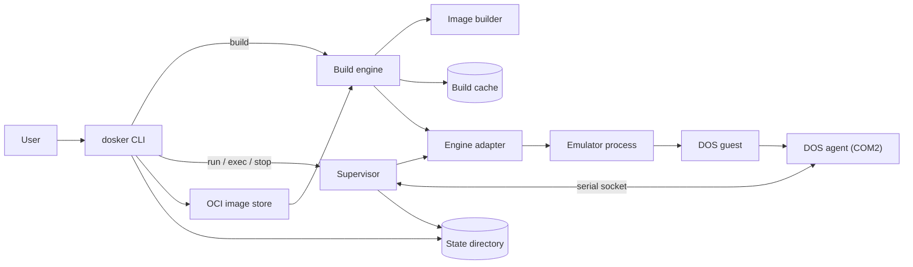
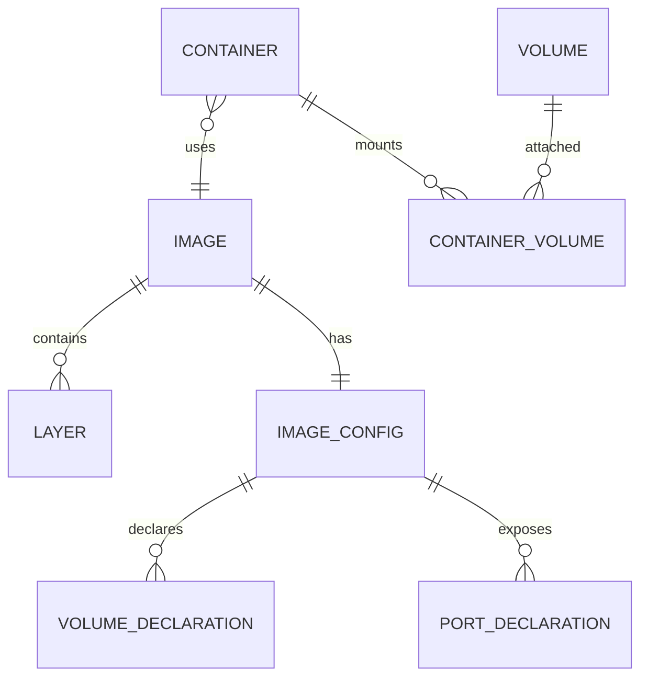

# DOSker — Design

- **Date**: 2026-11-01
- **Status**: Approved
- **Input**: `task.md` — a Docker-like system for launching pre-configured DOS systems.

## Index

| Asset | Path | Purpose |
| --- | --- | --- |
| Design document | `design.md` | This document |
| Data model | [`data-model.md`](data-model.md) | Entities, layer format, container lifecycle, data flow |
| Doskerfile contract | [`contracts/doskerfile.md`](contracts/doskerfile.md) | Grammar and instruction semantics |
| Agent protocol contract | [`contracts/agent-protocol.md`](contracts/agent-protocol.md) | Serial frame format and command set |
| Engine research | [`assets/engine-research.md`](assets/engine-research.md) | Capability evidence and source links for QEMU, DOSBox-X, and Bochs |
| Engine fallback analysis | [`assets/engine-fallback-analysis.md`](assets/engine-fallback-analysis.md) | Benefits and drawbacks of a QEMU-only system, and what to preserve now |
| QEMU-only deep dive | [`assets/qemu-only-deep-dive.md`](assets/qemu-only-deep-dive.md) | Question-by-question changes and positive outcomes if DOSker drops DOSBox-X and Bochs |

## Context And Problem

DOS software is hard to reproduce. An environment depends on the DOS flavour, the boot media, the emulator, the machine profile, and the files on disk. Today a user assembles these by hand, or starts a generic Docker image that wraps DOSBox. Neither gives layered environments, reproducible builds, headless control, or debugging across engines.

`task.md` asks for a Docker-like system for pre-configured DOS systems. It must run on several execution engines, use Dockerfile-like layered definitions, run many containers, work headless with remote control, expose debugging, and support several DOS flavours.

This design turns that idea into a concrete system. The first user is a developer who builds and tests DOS software in CI. The same model must later serve legacy applications, games, BBS software, and preservation.

## Goals And Non-Goals

### Goals

- Build reproducible DOS images from layered Doskerfiles with a cache.
- Run containers headless, in parallel, with per-container supervisors.
- Support QEMU first, then DOSBox-X and Bochs, through capability-based adapters.
- Execute commands inside DOS and return output and status.
- Provide a serial command shell and pass through native engine debuggers.
- Default to a locally built FreeDOS base. Accept user-provided proprietary DOS images and raw booter images.
- Provide FAT image volumes, user-mode NAT, and host port publishing.
- Pin base images, engines, and the agent in a lock file.
- Store images in the local OCI image layout.
- Work on Linux x86_64, macOS arm64, and Windows x86_64 from the first release.
- State the security limits plainly.

### Non-Goals

- DOSker is not a sandbox for untrusted code.
- Windows arm64 is out of scope. Windows x86_64 is in scope.
- A network registry, compose files, and shared L2 container networks are out of scope.
- Long file names are out of scope for the first release.
- Audio, advanced video, and game-specific tuning are out of scope.
- DOSker does not distribute MS-DOS or DR-DOS.
- Multi-stage builds, `ARG`, `ENTRYPOINT`, `HEALTHCHECK`, and `commit` are out of scope.
- A TCP control API is out of scope. Remote control uses SSH.
- CD-ROM and ISO media are out of scope.

## Requirements

### User Scenarios

#### Build and test a DOS program in CI (Priority: P1)

A developer writes a Doskerfile. It selects a FreeDOS base, copies the program, and runs a build command. The developer builds the image and runs a test command headless. The command returns output and a status. A failed command fails the CI job.

**Acceptance Scenarios**:

1. **Given** a valid Doskerfile and an unchanged cache, **When** the developer runs `dosker build`, **Then** every step reports a cache hit and no VM boots.
2. **Given** a built image, **When** the developer runs `dosker run -d` and `dosker exec`, **Then** the command output and status arrive, and the container is still running.
3. **Given** a command that exits with a non-zero status, **When** the developer runs `dosker exec`, **Then** the CLI exits non-zero and prints the status.

#### Reproduce a build on another machine (Priority: P1)

A developer commits a Doskerfile and its lock file. A different machine builds the same logical image with the pinned base, engine, and agent versions.

**Acceptance Scenarios**:

1. **Given** a committed lock file, **When** a second machine runs `dosker build`, **Then** it uses the pinned versions and reports a version mismatch instead of silently updating.
2. **Given** no lock file, **When** the first build runs, **Then** DOSker resolves versions and writes a lock file.

#### Debug a failing DOS program (Priority: P1)

A developer builds an image and starts a container. The program crashes in real mode. The developer connects the engine debugger and inspects registers and memory.

**Acceptance Scenarios**:

1. **Given** a running QEMU container, **When** the developer runs `dosker debug --gdb`, **Then** DOSker prints a GDB target command and leaves the debugger socket available.
2. **Given** an engine without a native debugger, **When** the developer runs `dosker debug`, **Then** DOSker reports that the capability is unavailable and names an engine that provides it.

#### Iterate on a program from a host directory (Priority: P1)

A developer maps a host directory into a container and edits files on the host. Changes appear in DOS without a rebuild.

**Acceptance Scenarios**:

1. **Given** a QEMU container started with a bind mount, **When** the developer saves a file on the host, **Then** the guest can read the new content.
2. **Given** a file name that is not valid in 8.3, **When** the container starts, **Then** DOSker refuses the mount and names the invalid path.

#### Run a booter image (Priority: P2)

A user imports a raw booter game. DOSker boots it and provides display and debugging, but not `exec`.

**Acceptance Scenarios**:

1. **Given** a booter image, **When** the user runs `dosker exec`, **Then** DOSker reports that the image has no agent.
2. **Given** a booter image, **When** the user runs `dosker run --display vnc`, **Then** the image boots and VNC is available.

#### Run several containers at once (Priority: P2)

A user starts two containers with published ports. Both run at the same time. A port conflict is an error.

**Acceptance Scenarios**:

1. **Given** two containers with different host ports, **When** both start, **Then** both are running and `dosker ps` lists them.
2. **Given** two containers that request the same host port, **When** the second starts, **Then** it fails and the first is unaffected.

#### Run the runtime slice on Windows (Priority: P1)

A developer on Windows x86_64 imports a prepared FreeDOS image, starts it headless, runs a command, and stops it. The CLI and supervisor use a named pipe. The engine uses localhost TCP.

**Acceptance Scenarios**:

1. **Given** a Windows host and a prepared image, **When** the developer runs `dosker image import`, `dosker run -d`, and `dosker exec`, **Then** the output and status arrive.
2. **Given** a supervisor crash, **When** the developer runs `dosker ps`, **Then** the stale container is marked exited and no engine process remains.

### Functional Requirements

- **FR-001**: The system MUST parse a Doskerfile subset with `FROM`, `COPY`, `RUN`, `RUN --host`, `ENV`, `WORKDIR`, `CMD`, `MACHINE`, `ENGINE-CONFIG`, `EXPOSE`, `VOLUME`, `ENGINE`, and `REQUIRES`.
- **FR-002**: The system MUST build content-addressed layers from file deltas and flatten them into one image at run time.
- **FR-003**: The system MUST cache layer results by parent tree digest, current build config digest, normalized instruction, and input hashes.
- **FR-004**: The system MUST build a FreeDOS base image deterministically from pinned inputs.
- **FR-005**: The system MUST import a ready bootable DOS image and add the agent through a layer.
- **FR-006**: The system MUST treat a raw booter image as an opaque blob with `booter=true`.
- **FR-007**: `RUN` MUST execute inside DOS through the agent by default. `RUN --host` MUST execute against a staged tree.
- **FR-008**: The system MUST start a container headless under a per-container supervisor with no central daemon.
- **FR-009**: The system MUST execute a command through the agent and return captured text output and a status.
- **FR-010**: The system MUST provide a line-oriented `attach` shell.
- **FR-011**: The system MUST pass through the native debugger of the selected engine when the capability exists.
- **FR-012**: The system MUST store images in the local OCI image layout with DOSker media types.
- **FR-013**: The system MUST record resolved base image, engine, and agent versions in a lock file.
- **FR-014**: The system MUST support FAT image volumes and exclusive attachment to one running container.
- **FR-015**: The system MUST provide user-mode NAT and host port publishing on engines that declare the capability.
- **FR-016**: The system MUST reject an engine that does not satisfy a Doskerfile `REQUIRES` list.
- **FR-017**: The system MUST validate `COPY` paths as 8.3 and reject traversal and symlinks.
- **FR-018**: The system MUST keep the image read-only and write only to a private container disk.
- **FR-019**: The system MUST recover from a dead supervisor by marking stale state as exited on the next CLI call.
- **FR-020**: The system MUST document that it does not sandbox untrusted images.
- **FR-021**: The system MUST support Linux x86_64, macOS arm64, and Windows x86_64 from the first release.
- **FR-022**: The system MUST use a transport abstraction: Unix sockets on Linux and macOS, and named pipes on Windows for CLI to supervisor control.
- **FR-023**: The system MUST prevent orphan engines with a parent-death signal or process group on Linux and macOS, and a Job Object on Windows.

## Assumptions And Constraints

- A container is one emulated DOS machine, not a process on a shared kernel.
- The agent is the long-lived guest process. The container stays running after `CMD` exits. This differs from Docker and is deliberate.
- The canonical image is a DOS file tree plus disk metadata. A bootable FAT image is a projection of it.
- One clean boot per `RUN`. Batching consecutive `RUN` instructions is deferred until an engine can attribute changes per command.
- QEMU is the first engine and the only engine with NAT in the MVP.
- QEMU and Bochs on macOS arm64 come from Homebrew. DOSBox-X comes from its official arm64 release.
- Windows x86_64 is a first-release host. Windows arm64 is out of scope.
- On Windows, engine binaries come from official builds or a package-manager path. The QEMU source is settled in M1-W. The DOSBox-X and Bochs sources are settled in M4.
- The supervisor control endpoint is a Unix socket on Linux and macOS, and a named pipe on Windows.
- Engine endpoints use Unix sockets on Linux and macOS, and localhost TCP on Windows.
- Process cleanup uses a parent-death signal or process group on Linux and macOS, and a Job Object on Windows.
- QEMU x86 guests on macOS arm64 run under TCG. No hardware acceleration is expected.
- Engine processes are external. DOSker does not link or fork engine code.
- The DOS agent is a separate 16-bit 8086-compatible program built with OpenWatcom or ia16-gcc.
- The control agent owns COM2. COM1 stays free for the guest.
- The default machine is a 486DX2 with 16 MB of RAM, VGA, SB16, NE2000, two serial ports, and an IDE disk.
- DOSker is licensed MIT or Apache-2.0, dual.
- FreeDOS is GPL-2.0. Engine licenses remain with the engines.
- Images are trusted. The user must isolate untrusted input with an outer VM.

## Approaches Considered

### File tree canonical, FAT image as a projection — Recommended

- **Summary**: The canonical image is a tree of DOS files plus disk metadata. Layers are tree deltas. A bootable FAT image is generated for release and for in-DOS execution.
- **Trade-offs**: Two representations to keep in sync, and a read-back step after each in-DOS step. In exchange, layers are inspectable, cacheable, and portable across engines. Host commands see ordinary paths. 8.3 validation happens before an image exists. The same tree serves QEMU, DOSBox-X, Bochs, and development mode.
- **Decision**: Chosen. It is the only model where layers, caching, `RUN --host`, 8.3 enforcement, development mode, and OCI storage share one representation. The tree-to-FAT round trip is the main risk and is proven in a spike.

### Disk image canonical, filesystem or block diffs

- **Summary**: The raw disk image is the artifact. Layers are FAT filesystem diffs or block extents.
- **Trade-offs**: One artifact and exact boot state. Host commands need an extraction step. Diffs include boot sectors and geometry. Block diffs are large and fragile. Layer inspection is hard. OCI storage is awkward.
- **Decision**: Rejected. It keeps the read-back problem and makes layers opaque.

### Live directory canonical, export at release

- **Summary**: The host directory is the canonical form. Runtime mounts or syncs it. A release export produces an image.
- **Trade-offs**: Fastest edit-run loop and least code. Builds are not reproducible by default. QEMU `vvfat` is beta. Release images differ from what was tested. Boot metadata has no home.
- **Decision**: Rejected. It contradicts the reproducibility goal.

## Engine Strategy

The design keeps three engines, as the task requires. QEMU is the only engine required for M1 and M2. DOSBox-X and Bochs are capability-gated adapters. Their spikes must not block the QEMU slice.

The explicit comparison of the current multi-engine design against a later QEMU-only fallback is in [`assets/engine-fallback-analysis.md`](assets/engine-fallback-analysis.md). It records the positive outcomes and the negative drawbacks of dropping the other engines, the conditions that would justify a drop, and the design elements we keep now so the option stays open. The question-by-question change set and the positive outcomes of a QEMU-only system are in [`assets/qemu-only-deep-dive.md`](assets/qemu-only-deep-dive.md).

Decision: keep multi-engine for now. Re-evaluate after M4, when the DOSBox-X and Bochs spikes and adapters have produced evidence.

## Architecture

### Components

| Component | Responsibility | Depends On |
| --- | --- | --- |
| `dosker-cli` | Parse arguments, dispatch commands, format output | Runtime, build engine, image store |
| Supervisor (`dosker __supervise`) | Own one container, engine process, sockets, logs, and state | Engine adapter, agent protocol, state store |
| Engine adapter | Translate an `EngineSpec` into engine configuration and control | Engine binary |
| DOS agent | Execute commands, transfer files, and report status inside the guest | DOS, COM2 UART |
| Build engine | Apply instructions, run `RUN` steps, compute deltas, commit layers | Image builder, engine adapter, cache |
| Image builder | Build and read FAT images, manage boot metadata | Tree model |
| FreeDOS builder | Produce the default base image from pinned FreeDOS binaries, boot sectors, and the agent binary | Image builder |
| OCI store | Store layers, configs, manifests, and tags | Filesystem |
| State store | Track containers, volumes, engines, and locks | Filesystem |
| Host platform | Control transport, process cleanup, data directory, console | Operating system APIs |
| Agent protocol | Encode and decode host-side frames | Serial transport |

### Diagram



### Process Model

`dosker` is one Rust binary with two roles. It is the user-facing CLI, or a hidden per-container supervisor.

```
dosker build (foreground, no supervisor)
  └─ qemu (transient build VM)

dosker run -d
  └─ dosker __supervise
       ├─ qemu | dosbox-x | bochs
       ├─ control        CLI <-> supervisor (Unix socket or named pipe)
       ├─ serial-com2    supervisor <-> guest agent (Unix socket or localhost TCP)
       ├─ serial-com1    guest terminal (Unix socket or localhost TCP)
       ├─ qmp            supervisor <-> QEMU (Unix socket or localhost TCP)
       ├─ monitor        screenshots, shutdown
       └─ gdb            debugger pass-through
```

The agent owns COM2. COM1 stays available to the guest. The adapter maps the two endpoints to the first two serial ports of the engine. The endpoint kind depends on the host, not on the engine.

The supervisor starts the engine, waits for the agent banner, owns all engine sockets, proxies `exec` and `attach`, records state, writes logs, reaps the engine, and stores the final status. The CLI exits after it starts a detached container.

There is no central daemon. `dosker ps` reads the state directory. `dosker exec`, `attach`, `stop`, and `debug` connect to the control endpoint. A dead supervisor leaves a stale entry that the next CLI call marks as exited. A container failure does not affect another container.

On Linux the supervisor sets a parent-death signal for the engine. On macOS it uses a process group and endpoint liveness. On Windows it uses a Job Object with kill-on-close and endpoint liveness. A build VM is transient and is always killed on error. A failed build commits no layer.

### Engine Capability Matrix

This is the expected state at design time. Unproven cells are settled by M0 spikes. The table in code is the single source of truth.

| Capability | QEMU | DOSBox-X | Bochs |
| --- | --- | --- | --- |
| Core boot, serial, stop | Yes | Yes, `BOOT` needs a spike | Yes |
| `headless` | Yes | Unproven | Yes |
| `host_dir_live` | Yes, `vvfat` | Yes, `MOUNT` | Yes, `vvfat` |
| `debug_native` | Yes, gdbstub | Unproven | Yes, internal debugger |
| `gdbstub` | Yes | No | Build-dependent |
| `screenshot` | Yes | Unproven | Unproven |
| `vnc` | Yes | No | Build-dependent |
| `nat` | Yes | Unproven | Unproven |
| `audio` | Later | Later | Later |

A Doskerfile can require a capability with `REQUIRES`. DOSker rejects an engine that lacks it and names the engines that provide it. NAT is a QEMU capability in the MVP.

### Host Platform Abstraction

| Host | Supervisor control | Engine endpoints | Process cleanup | Data root |
| --- | --- | --- | --- | --- |
| Linux x86_64 | Unix socket | Unix socket | Parent-death signal and process group | XDG data directory |
| macOS arm64 | Unix socket | Unix socket | Process group | Application Support |
| Windows x86_64 | Named pipe | localhost TCP | Job Object | `%LOCALAPPDATA%\dosker` |

Engine availability by host:

| Host | QEMU | DOSBox-X | Bochs |
| --- | --- | --- | --- |
| Linux x86_64 | Yes | Yes | Yes |
| macOS arm64 | Homebrew | Official arm64 build | Homebrew |
| Windows x86_64 | Official build, verify in M1-W | Official build, verify in M4 | Official build, verify in M4 |

The `dosker-platform` crate owns the control transport, process cleanup, data directory, and console. The JSON-lines control protocol and the agent protocol are the same on every host.

- A Windows named pipe uses a DACL that allows only the current user.
- Windows engine endpoints bind to `127.0.0.1` only.
- State writes use `rename` on Unix and `ReplaceFileW` on Windows.
- Host paths use Rust `Path`. DOS paths always use backslash and 8.3.
- A private disk uses a reflink when the host filesystem supports it and a full copy otherwise. Windows falls back to a full copy in the MVP.

### Workspace Crates

- `dosker-core`: domain types, Doskerfile parser, lock file, errors.
- `dosker-image`: file tree, layers, FAT builder and reader, OCI layout.
- `dosker-engine`: adapter trait, capability model, engine discovery.
- `dosker-engine-qemu`, `dosker-engine-dosbox-x`, `dosker-engine-bochs`: one crate per adapter.
- `dosker-agent-proto`: host-side frame codec.
- `dosker-runtime`: supervisor, container state, lifecycle.
- `dosker-platform`: control transport, process cleanup, data directory, console.
- `dosker-cli`: argument parsing and commands.
- `dosker-test-support`: mock engine, fixtures, golden files.
- `agent/`: 16-bit DOS sources and build files. Not a Rust crate.

### State Directory

Use the XDG data directory on Linux, the Application Support directory on macOS, and `%LOCALAPPDATA%\dosker` on Windows. `DOSKER_ROOT` overrides the root for tests.

```
~/.local/share/dosker/
  images/            OCI image layout
  containers/<id>/   state.json, disk.img, endpoints, logs, config
  volumes/<name>/    volume.img, meta.json
  engines/           managed engine binaries and checksums
  cache/             build cache
  tmp/               in-progress builds
```

### Data Flow

1. `dosker build` reads the Doskerfile and the build context.
2. `FROM` resolves to a local image, a FreeDOS base build, or an import.
3. `COPY` and `RUN --host` modify the staged tree.
4. `RUN` materializes a bootable image, starts a transient VM, sends the command to the agent, shuts down, reads the tree back, and computes a delta.
5. Each filesystem instruction commits a content-addressed layer, or reuses a cache hit. Config-only instructions update the build config and the history.
6. The final image is written to the OCI store and the lock file is updated.
7. `dosker run` creates a private writable disk, starts the supervisor, boots the engine, waits for the agent, and sends `CMD`.
8. `exec` sends a command over the control endpoint to the supervisor, which frames it to the agent.
9. `stop` flushes the guest, quits the engine, and updates state.

## Component Interfaces

### Engine Adapter

- **Purpose**: Hide engine differences behind one contract.
- **Interface**:
  - `name()` and `version()` identify the engine.
  - `capabilities()` returns the declared capability set.
  - `probe()` checks the binary and returns its version.
  - `build_command(spec, paths)` produces the engine command line and config files.
  - `start(spec)` starts the engine process.
  - `wait_ready(timeout, expects_agent)` waits for the agent `HELLO` when the image has an agent. A booter image is ready when the engine process is alive.
  - `stop(mode)` performs a graceful stop.
  - `kill()` stops the process immediately.
  - `screenshot()` captures the screen when supported.
  - `debug_endpoint(kind)` returns a socket or pseudo-terminal for the native debugger.
- **Failure Modes**: A missing binary, a version mismatch, a refused capability, a boot timeout, or an engine crash returns a typed error. The supervisor records the error and keeps the last serial line.

### Supervisor

- **Purpose**: Own one container for its whole lifetime.
- **Interface**: A JSON-lines protocol over the control endpoint. The endpoint is a Unix socket on Linux and macOS, and a named pipe on Windows.
  - `exec {command, env, workdir, timeout}` returns `{exit_code, output, timed_out, truncated}`.
  - `attach` switches the client to a line shell.
  - `stop {grace}` stops the container.
  - `status` returns the container state.
  - `debug {kind}` returns `{kind, endpoint}`.
  - `cp {direction, source, destination}` transfers a file.
  - `ping` proves liveness.
- **Failure Modes**: A malformed message closes the connection. A guest timeout returns `timed_out`. A lost engine marks the container exited.

### DOS Agent

- **Purpose**: Provide the only controlled channel into the guest.
- **Interface**: The frame protocol in [`contracts/agent-protocol.md`](contracts/agent-protocol.md).
- **Failure Modes**: A CRC error triggers a retry. Three retries close the session. A busy guest returns `BUSY`. A missing command returns `COMMAND_NOT_FOUND` when `COMMAND.COM` reports it.

### Build Engine

- **Purpose**: Turn a Doskerfile into a set of layers and an image.
- **Interface**: `build(context, tag, options) -> image digest` and a progress stream.
- **Failure Modes**: An invalid instruction, a cache corruption, a boot timeout, a non-zero `RUN`, or a disk-full error aborts the build and removes temporary state.

### Control Endpoint Encoding

Messages are UTF-8 JSON, one object per line, over the control endpoint. The endpoint is a Unix socket on Linux and macOS, and a named pipe on Windows. Engine endpoints use Unix sockets on Linux and macOS, and localhost TCP on Windows. Binary file data is not sent on the control endpoint. `cp` streams through the agent or reads the stopped disk with the FAT reader.

### CLI

| Command | Purpose |
| --- | --- |
| `dosker build [-t tag] [--update] [--no-cache] [--timeout N] .` | Build an image from a Doskerfile |
| `dosker run [-d] [--name N] [--rm] [-p [addr:]host:guest] [-v name:drive[:ro]] [--bind drive:path[:ro]] [--engine E] [--boot-timeout N] [--display none\|window\|vnc] [--vnc-port N] IMAGE` | Create and start a container |
| `dosker create`, `start [--boot-timeout N]`, `stop`, `restart`, `rm` | Container lifecycle |
| `dosker ps [-a]`, `inspect`, `logs [-f]`, `port` | Inspect containers |
| `dosker status CONTAINER` | Report one container from the supervisor or the recovered state |
| `dosker exec [-e K=V] [-w PATH] [--timeout N] CONTAINER COMMAND` | Run a command through the agent |
| `dosker attach CONTAINER` | Open the line shell |
| `dosker cp CONTAINER:SRC HOST` and `dosker cp HOST CONTAINER:DST` | Transfer a file in or out |
| `dosker debug [--gdb] CONTAINER` | Attach the native debugger or print the GDB target |
| `dosker screenshot CONTAINER -o FILE` | Capture the guest screen when the engine supports it |
| `dosker image import [--booter] FILE name:tag` | Import a raw DOS image and inject the agent, or import a booter blob |
| `dosker images`, `rmi`, `tag`, `save`, `load` | Manage images |
| `dosker volume create [--size 64M] NAME`, `ls`, `rm` | Manage volumes |
| `dosker engines`, `doctor` | Show engine versions and capabilities, and check the host |
| `dosker system prune` | Remove stopped containers, unused images, and cache entries |

## Data Model

The full model is in [`data-model.md`](data-model.md). The main entities are:



An image is a config plus ordered layers. A normal layer is a tar blob with a JSON sidecar. A booter image has one raw blob instead of a tree. A container is a writable disk plus state and sockets. A volume is a FAT image with a lock.

## Build And Runtime Semantics

### Build

- `dosker image import [--booter] FILE name:tag` reads a raw image. A DOS image gets the agent injection layer. A booter image is stored as an opaque blob.
- The FreeDOS base includes `CONFIG.SYS` with `LASTDRIVE=Z`, `FILES=20`, and `BUFFERS=10`, and an `AUTOEXEC.BAT` that starts the agent.
- `FROM` resolves a local tag or digest, a built-in FreeDOS base, an imported DOS image, or a booter blob. An imported DOS image gets an agent injection layer that adds `C:\DOSKER\DOSKER.EXE` and wraps `AUTOEXEC.BAT`.
- `COPY` adds files to the staged tree with fixed timestamps and 8.3 validation.
- `RUN --host` runs in a temporary staged tree that represents `C:\`. The host shell is `/bin/sh -c` on Unix and `cmd.exe /C` on Windows. It folds the result into a layer. It rejects invalid 8.3 names and symlinks.
- `RUN` boots one transient VM per instruction, sends the command to the agent, reads the tree back, and folds the delta into a layer. Before the boot, the build engine writes `C:\DOSKER\CONFIG.INI` with the control port and baud. It excludes that file and agent temporary files from the read-back delta, and it ignores the `C:\DOSKER` directory timestamp. After shutdown, it also reads the MBR, partition table, and boot sector. A change updates the layer's boot metadata and the image config.
- After every filesystem instruction, the builder restores the agent files under `C:\DOSKER`. Changes to that directory are discarded.
- Config-only instructions update the build config and history. They do not add an OCI filesystem layer.
- A `RUN` VM has the same network capability as the image. A command that downloads data is not reproducible. A `RUN --host` command also has host network access. The docs state this.
- A cache entry is keyed by the parent tree digest, the current build config digest, the normalized instruction, and the input hashes. The config digest makes an `ENV`, `WORKDIR`, or `MACHINE` change invalidate later steps.
- A failed instruction commits no layer and removes temporary state.

### Runtime

- `create` makes a private writable disk from the image. It uses a reflink when the host filesystem supports it and a full copy otherwise. The image stays read-only.
- `stop` and `start` keep the writable disk. `rm` discards it.
- Before boot, the supervisor writes `C:\DOSKER\CONFIG.INI` with the control port and baud.
- `start` waits up to 60 seconds for the agent `HELLO`. It then sends `CMD` if the image has one.
- Without `-d`, `run` starts the container and attaches the line shell. The shell can detach without stopping the container.
- `stop` sends `SHUTDOWN` and waits for `READY_TO_STOP`. It stops the engine after a grace period. A kill sets `dirty=true`.
- A booter image has no agent. `start` marks it running when the engine process is alive. `stop` uses the engine control channel and then kills after the grace period.
- `--display none|window|vnc` selects the display. The default is `none`. A booter image needs a display to be useful. `--vnc-port` defaults to a free local port. `dosker port` reports the effective port.
- The agent is the long-lived guest process. When `CMD` exits, the container stays running and the agent waits for the next command. `stop` or `rm` ends it.
- `exec` sends a command through the agent. It returns text output and the DOS status. A timeout kills the engine.
- `attach` is a line shell. It handles `cd` locally and sends the effective workdir with each command. Full-screen programs need the optional video capability.
- `cp` on a running container uses the agent and is limited to small files. Larger files use a volume or a stopped container.
- A named volume is a partitioned FAT16 disk image that attaches to at most one running container. Small volumes may use a superfloppy. It survives `rm`. `-v name:D:` mounts read-write. `:ro` mounts read-only.
- `-p host:guest` publishes a guest TCP port. The default host address is `127.0.0.1`. NAT is a QEMU capability in the MVP.
- `--bind D:/host/path` uses a live host directory where the engine supports it. Add `:ro` for read-only. On QEMU this uses `vvfat`, with the documented beta warning and no CI use.
- A dead supervisor leaves stale state. The next CLI call marks the container exited and keeps the disk.

## API Contracts

- Doskerfile grammar and instruction semantics: [`contracts/doskerfile.md`](contracts/doskerfile.md).
- Agent frame format and commands: [`contracts/agent-protocol.md`](contracts/agent-protocol.md).

OCI media types:

- `application/vnd.dosker.layer.v1.tar`
- `application/vnd.dosker.image.config.v1+json`
- `application/vnd.dosker.booter.v1.raw` for the single opaque booter blob
- Standard OCI manifest and index types for the outer objects.

## Error Handling And Edge Cases

- **Missing engine or version mismatch**: stop with a message that names the expected and found versions. `--update` refreshes the lock.
- **Capability missing**: reject the build or run, and name the engines that provide the capability.
- **Agent protocol mismatch**: stop the container and report the image agent version and the supported version.
- **Boot timeout**: stop the engine, print the last serial line, and suggest a larger deadline or a machine profile change.
- **No agent (booter image)**: `exec`, `attach`, and `cp` on a running booter return `no_agent`. `run`, `screenshot`, and `debug` still work.
- **Guest busy**: `exec` while an application runs returns a timeout or `BUSY` after the deadline.
- **Command timeout**: the supervisor kills the engine and marks the container exited. The disk is kept.
- **Guest reboot during a command**: the supervisor sees a second agent `HELLO` and fails the command with `guest_rebooted`. Reboot-based installers are not supported in the MVP.
- **Dirty FAT after a kill**: report the dirty flag on the next start. A repair command is deferred.
- **Port conflict**: fail the start and leave other containers untouched.
- **Volume already attached**: fail the second start with the name of the holder.
- **Stale state**: a missing supervisor process or dead socket marks the container exited.
- **Cache corruption**: a digest mismatch deletes the entry and rebuilds it.
- **Disk full**: fail the build or start before booting, with the required and available sizes.
- **Invalid 8.3 path**: fail `COPY` or a bind mount before execution.
- **Symlink or traversal**: reject the path and name the source.
- **Protocol CRC failure**: retry the frame three times, then close the session.
- **Engine crash**: record the exit code, keep the disk, and mark the container exited.

## Security And Privacy

- DOSker runs arbitrary DOS code. QEMU TCG is not a security boundary. The README and `dosker doctor` state this.
- The tool does not claim to contain hostile images. Use an outer VM or an isolated CI runner for untrusted input.
- The supervisor control endpoint is a Unix socket in a mode 0700 container directory on Linux and macOS, and a named pipe with a user-only DACL on Windows. Engine endpoints use Unix sockets where the engine supports them, and localhost TCP otherwise. Windows engine endpoints bind to `127.0.0.1` only.
- Published ports bind to `127.0.0.1` by default. A LAN bind requires an explicit address.
- `ENGINE-CONFIG` is trusted. It can pass powerful engine options.
- `COPY` rejects traversal, absolute paths outside the context, and symlinks.
- Managed engine downloads are verified against pinned checksums.
- DOSker stores no secrets. Image configs and lock files are plain text.
- FreeDOS is built locally from a pinned upstream distribution. DOSker does not redistribute MS-DOS or DR-DOS.
- DOSker is dual-licensed MIT or Apache-2.0. Engine licenses remain with the engines.

## Non-Functional Requirements

- **Performance**: A cached build performs no VM boot. A cold `RUN` boots one VM per instruction. The agent reports a boot and transfer baseline in the first milestone.
- **Reliability**: State writes are atomic. Images are never modified. A failed build commits no layer.
- **Portability**: Linux x86_64, macOS arm64, and Windows x86_64 are supported. Paths, control endpoints, process cleanup, and engine endpoints use the `dosker-platform` abstraction.
- **Observability**: `engine.log`, `serial.log`, and `container.log` record the engine, the guest link, and command history. `dosker inspect` prints the effective command line.
- **Maintainability**: Engine differences stay inside adapter crates. The agent stays small and has no runtime dependency beyond DOS.
- **Compatibility**: FreeDOS is the first target. MS-DOS 5.0 and 6.22 and DR-DOS are tested when the user supplies an image. The agent is built for 8086 real mode.
- **Usability**: Errors name the failing component and the next action. The capability matrix is visible through `dosker engines`.

## Testing Strategy

**Unit tests** cover the parser, `$NAME` expansion, layer codec and digest stability, cache keys, FAT builder and reader, boot metadata, 8.3 validation, lock resolution, state transitions, stale detection, control transport (Unix socket and named pipe), frame codec, CRC and retry, engine config generation with golden files, and capability matching.

**Adapter contract tests** use a mock engine that implements the expected sockets and lifecycle. The same contract suite checks each adapter's generated command line and declared capabilities.

**Real-engine integration tests** are gated by `DOSKER_INTEGRATION=1` and cover:

- QEMU headless boot of a FreeDOS image, `HELLO`, `EXEC`, output, status, `PUT`/`GET`, and clean stop.
- A full build with `FROM`, `COPY`, `RUN`, and a cache hit.
- DOSBox-X `BOOT` of the same image.
- Bochs headless boot and internal debugger.

The QEMU integration test runs on Linux in CI. On macOS arm64 it runs in a nightly job because TCG is slower.

**Agent tests** use Rust unit tests for the codec and a `/TEST` self-check mode inside the DOS agent. A conformance test runs the Rust codec against the real agent in QEMU.

**CI** runs formatting, clippy, and dependency checks on every commit. Unit and mock tests run on Linux, macOS, and Windows. QEMU integration runs on Linux. A Windows QEMU smoke test runs in CI. The 16-bit agent cross-build runs on Linux. Engine versions are pinned.

**Security tests** check path traversal, symlink rejection, invalid 8.3 names, socket permissions, missing engines, and version mismatches.

## Rollout And Compatibility

This is a new project. There is no migration.

Versioned formats:

- Doskerfile syntax version 1.
- Layer format version 1.
- Image config version 1.
- Lock file version 1.
- Agent protocol version 1.

A format version change is a breaking change and needs a migration or a new version. The local OCI layout and the standard tar layers make a later registry move possible without rewriting the image model.

### Planning Note

This design covers the whole system and spans several independent subsystems. The first implementation plan covers M0, M1, and the Windows M1-W track. M2 to M5 become follow-up plans. Do not start M2 before the M0 spikes settle the FreeDOS builder, the agent, the Windows transport, and the DOSBox-X boot path.

### Milestones

**M0: spikes.** Each spike is throwaway proof, not product code.

1. QEMU headless boot of a hand-built FreeDOS image with a serial echo and the agent protocol.
2. Deterministic FreeDOS base builder. Prove the boot sector, MBR, and geometry.
3. DOSBox-X `BOOT` of the same image. Confirm headless, serial, and debugger availability.
4. Bochs headless boot, serial, and internal debugger.
5. NAT on DOSBox-X and Bochs, if either can provide it without root.

**M1: runtime slice (first usable).** QEMU adapter, supervisor, agent, `image import`, `create`, `start`, `stop`, `rm`, `run -d`, `exec`, `attach`, `logs`, `screenshot`, `engines`, `doctor`, and a basic QEMU gdbstub pass-through. The image is prepared by M0 and loaded with `image import`, not built by DOSker.

**M1-W: Windows runtime track.** Named-pipe control transport, Job Object cleanup, Windows data directory, engine discovery, and the QEMU runtime slice on Windows x86_64. It runs in parallel with M1 and is a first-release gate.

**M2: build slice.** OCI store, layers, Doskerfile parser, `COPY`, `RUN --host`, `RUN`, cache, lock file, the FreeDOS base builder, and `dosker build`.

**M3: data and network.** Volumes, NAT and port publishing, host bind mounts, and development mode.

**M4: more engines.** DOSBox-X first, then Bochs. The capability matrix is populated by the spikes. Debugger pass-through for Bochs.

**M5: packaging.** `save`/`load`, `system prune`, macOS and Windows engine discovery, docs, install instructions, and release artifacts for Linux, macOS, and Windows.

**M1 definition of done.** `dosker image import freedos-test.img freedos-test` loads the prepared image. `dosker run -d --name test freedos-test` boots with no window. `dosker exec test ECHO HELLO` returns `HELLO` and status 0. `dosker attach test` gives a working command shell. `dosker stop test` flushes and exits. `dosker start test` returns to the same disk. The QEMU gdbstub is reachable on a socket. `dosker engines` reports the QEMU version and capabilities. Logs show the engine output and the serial transcript.

**M1-W definition of done.** The same slice passes on Windows x86_64. The CLI reaches the supervisor through a named pipe. The engine uses localhost TCP. A supervisor crash leaves no engine process because the Job Object closes. `dosker engines` finds the Windows QEMU build and reports its capabilities.

## Risks

| Risk | Impact | Mitigation |
| --- | --- | --- |
| The deterministic FreeDOS builder is harder than expected | Blocks every image | Spike first. Fall back to a one-time `SYS` in a VM, with a documented reproducibility cost. |
| The DOS agent fails on some DOS flavours | Blocks `exec` and build | Build for 8086 real mode. Test FreeDOS and MS-DOS 6.22. Add a self-test mode. |
| Guest software uses the agent control port | `exec` and build fail | Default to COM2, make the control port a `MACHINE` setting, and document the conflict. |
| QEMU `vvfat` corrupts host files | Data loss in development mode | Development only. Prominent warning. Sync fallback. No CI use. |
| DOSBox-X `BOOT`, headless, or debugger fails | Engine gap | Declare the capability unavailable. Use QEMU or Bochs for that feature. |
| Serial speed limits file transfer | Slow builds | Measure in the spike. Raise the baud rate. Add compression later. |
| One boot per `RUN` is slow | Poor developer experience | Cache aggressively. Show timings. Revisit batching after engine snapshots. |
| Auto-sized FAT volume is too small for an installer | `RUN` fails with `NO_SPACE` | Leave free space, report the required and available sizes, and add an explicit `DISK` instruction later. |
| macOS engine quality varies | Bad macOS experience | Homebrew discovery with a version pin. Nightly macOS CI. |
| Windows named pipes and console behavior differ | Host-specific bugs | A `dosker-platform` abstraction and Windows CI. |
| Windows engine builds are less uniform | Version and capability mismatch | Official builds with checksums, a version check, and the M1-W spike. |
| Windows Job Object cleanup fails | Orphan engines | Assign the engine to a Job Object with kill-on-close. Test a supervisor crash. |
| Scope grows into gaming and BBS features | Delays the core | Capability model and milestone order. Defer game-specific display, audio, and BBS features. |
| Users treat DOSker as a sandbox | Host compromise | State the threat model in the README and `dosker doctor`. Recommend an outer VM. |
| FreeDOS and engine licenses | Legal risk | Build images locally. Keep engines external. MIT/Apache-2.0 for DOSker. Publish source offers. |

## Open Questions

| Question | Owner | Resolution Path |
| --- | --- | --- |
| Can `makebootfat` or a custom writer produce a bootable FreeDOS image file reliably? | M0 spike | Build the base image and boot it on QEMU and DOSBox-X. |
| Does DOSBox-X `BOOT` a DOSker image, and can it run headless with the debugger? | M0 spike | Boot the same image and test `-silent`, the dummy video driver, and the debugger. |
| Can the serial link run above 115200 baud on all engines? | M0 spike | Measure throughput and CRC errors. |
| Does Bochs' gdbstub support 16-bit real mode in a packaged build? | M0 spike | Test a build with `--enable-gdb-stub`. |
| Can DOSBox-X or Bochs provide user-mode NAT without root? | M0 spike | Test networking and declare the capability only if it works. |
| Do we add long file names after the MVP? | User | Deferred. Revisit when FreeDOS LFN support is proven. |
| Do we add registry push and pull? | User | Deferred. The local OCI layout keeps the option open. |
| Do we add a shared L2 network? | User | Deferred. It needs a virtual switch and per-engine NIC mapping. |
| Which Windows engine builds are the most reliable? | M1-W and M4 spikes | Verify the QEMU build in M1-W and the DOSBox-X and Bochs builds in M4. |
| Can the control protocol run over Windows named pipes without change? | M1-W spike | Implement the `dosker-platform` transport and run the contract suite. |
| Do Windows engine endpoints behave the same over localhost TCP? | M1-W spike | Test QMP, serial, monitor, gdbstub, VNC, and NAT. |
| Do we support Windows arm64? | User | Deferred. It needs arm64 engine builds and a separate CI runner. |
| Do we add a `commit` command or `CD-ROM`/ISO media? | User | Deferred. |
| Do we add `ARG`, multi-stage builds, or `ENTRYPOINT`? | User | Deferred. They add syntax and cache rules. |
| Can the agent be distributed under MIT/Apache-2.0 when it links OpenWatcom runtime code? | User | Check the OpenWatcom runtime license. Use ia16-gcc if the terms conflict. |
| Do we transcode DOS code pages to UTF-8 for `exec` and `attach`? | User | Deferred. The MVP passes bytes through unchanged. |

## Success Criteria

SC-001, SC-005, SC-006, and SC-007 are the M1 gate. SC-002 and SC-004 are verified in M2. SC-003 is verified in M4.

- **SC-001**: `dosker run -d --name test freedos-test` boots with no window. `dosker exec test ECHO HELLO` returns `HELLO` and status 0. `dosker attach test` gives a working shell. `dosker stop test` flushes and exits. `dosker start test` returns to the same disk. The QEMU gdbstub is reachable on a socket.
- **SC-002**: `dosker build` turns a Doskerfile with `FROM`, `COPY`, `RUN`, and `CMD` into a runnable image. A second build reports cache hits and boots no VM.
- **SC-003**: The same image boots on QEMU and DOSBox-X, or the capability table states precisely why it does not.
- **SC-004**: A committed lock file makes a second machine use the pinned base, engine, and agent versions. A mismatch stops the build.
- **SC-005**: Every declared capability is backed by an integration test or marked unproven in the capability table.
- **SC-006**: The unit, mock, and QEMU integration suites pass on Linux. Unit and mock suites pass on macOS.
- **SC-007**: The M1 runtime slice passes on Linux x86_64, macOS arm64, and Windows x86_64. The Windows run uses a named pipe for control, a Job Object for cleanup, and no orphan engine remains after a supervisor crash.
