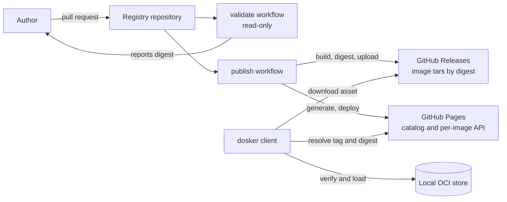
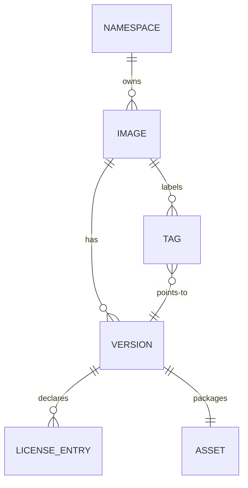

# DOSkerfile Registry — Design

- **Date**: 2026-11-22
- **Status**: Approved
- **Input**: Design a DOSker image registry like Docker's counterpart, hostable on GitHub Pages with Releases for binary builds, and add license information to the Doskerfile, including an exception for abandonware.

## Index

| Asset | Path | Purpose |
| --- | --- | --- |
| Design document | `design.md` | This document |
| Namespace schema | [`contracts/namespaces.schema.json`](contracts/namespaces.schema.json) | `namespaces.toml` contract |
| Image metadata schema | [`contracts/registry.schema.json`](contracts/registry.schema.json) | `registry.toml` contract |
| Takedown schema | [`contracts/revoked.schema.json`](contracts/revoked.schema.json) | `revoked.toml` contract |
| Catalog schema | [`contracts/catalog.schema.json`](contracts/catalog.schema.json) | Generated `/index.json` contract |
| Image index schema | [`contracts/image-index.schema.json`](contracts/image-index.schema.json) | Generated `/v1/<owner>/<name>/index.json` contract |
| License record schema | [`contracts/licenses.schema.json`](contracts/licenses.schema.json) | Generated per-version license record contract |
| Validate workflow | [`assets/workflows/validate.yml`](assets/workflows/validate.yml) | Read-only pull-request validation workflow for the registry repo |

## Context And Problem

DOSker stores images in a standard OCI image layout. It can build images from a Doskerfile, import disks, and move images with `dosker save` and `dosker load`. It has no network distribution. A user cannot pull a shared image, and a publisher cannot publish one. The existing DOSker spec defers a registry (`design.md:616` and `roadmap.md:369-370`).

DOSker images bundle third-party software. Some of that software is open source, some is freeware, and some is abandonware. The Doskerfile has no way to declare those terms. The current project avoids the problem by building FreeDOS locally and not redistributing it (`docs/base-images.md:3-4`). A registry must change that posture and must make licensing explicit and reviewable.

The request has two parts. First, a registry that is static and cheap to host: GitHub Pages serves the catalog, and GitHub Releases serve the image tarballs and binary builds. Second, a license model in the Doskerfile, with a declared abandonware exception, so an image that contains abandonware can be distributed under a stated policy.

## Goals And Non-Goals

### Goals

- Publish and curate images through a reviewed pull request to one central registry repository.
- Serve a browsable and searchable catalog from GitHub Pages with no server code.
- Serve immutable image tarballs from GitHub Releases, addressed by digest.
- Let the client pull, search, and inspect remote images, and verify every digest.
- Add a repeatable, structured `LICENSE` instruction to the Doskerfile.
- Enforce license declarations in CI, and show them on Pages.
- Require an explicit, digest-keyed user acceptance before an abandonware image is pulled.
- Reuse the existing OCI manifest, layer, tree, and digest model.
- Keep the whole registry reproducible from the repository and its Releases.

### Non-Goals

- A CLI `push` command, user accounts, or private registries.
- A live OCI Distribution API.
- Automated signing or attestation in the first version.
- Federation, mirroring, or a CDN.
- Images whose tar exceeds 2 GiB.
- Automatic rebuilds when a base image moves.
- Any legal ruling on an abandonment claim. The registry records a claim and follows a takedown policy. It does not certify legality.

## Requirements

### User Scenarios

#### Pull and run a registry image (Priority: P1)

A user runs `dosker pull i-zhirov/wolf3d:latest`. The client resolves the tag on Pages, downloads the tar from the Release, verifies the digests, and stores the image locally as `i-zhirov/wolf3d:latest`. The user then runs `dosker run i-zhirov/wolf3d:latest`.

**Acceptance Scenarios**:

1. **Given** a published image and a clean data root, **When** the user runs `dosker pull i-zhirov/wolf3d:latest`, **Then** the image is stored and both the asset digest and the manifest digest match.
2. **Given** a stored image, **When** the user runs `dosker run i-zhirov/wolf3d:latest` with no network, **Then** the container starts from the stored image.

#### Publish an image by pull request (Priority: P1)

A publisher forks the registry repository and adds `images/<owner>/<name>/Doskerfile` and `registry.toml`. CI validates the files, and a maintainer reviews them. After the merge, CI builds the image, uploads the tar to a Release, and redeploys Pages.

**Acceptance Scenarios**:

1. **Given** a valid new image directory, **When** the pull request is opened, **Then** validation passes and reports the manifest digest.
2. **Given** a merged image with version `1.0.0`, **When** publish runs, **Then** the Release has the tar and the catalog lists `1.0.0` with the same digest.
3. **Given** a published version `1.0.0` with a different digest, **When** publish runs again, **Then** publish fails.

#### Bundle abandonware with a declared basis (Priority: P1)

A publisher includes an old game. The Doskerfile declares `STATUS=abandonware` with a basis and an evidence URL. CI accepts the entry. Pages shows a notice. The client refuses to pull until the user accepts the digest.

**Acceptance Scenarios**:

1. **Given** an `abandonware` entry without `EVIDENCE`, **When** validation runs, **Then** validation fails.
2. **Given** a published abandonware image, **When** the user runs `dosker pull` without an acceptance flag, **Then** the pull stops and prints the entries.
3. **Given** the same image and `--accept-license <digest>`, **When** the user pulls again, **Then** the image is stored and the acceptance is recorded.

#### Publish a redistributable image (Priority: P1)

A publisher declares only redistributable software. No acceptance is needed.

**Acceptance Scenarios**:

1. **Given** a valid `redistributable` entry, **When** the image is published, **Then** `pull` downloads it without a prompt.

#### Search and inspect (Priority: P2)

A user runs `dosker search wolf` and then `dosker image inspect i-zhirov/wolf3d:latest`.

**Acceptance Scenarios**:

1. **Given** the catalog on Pages, **When** the user searches, **Then** matching images are listed with description, tags, and license summary.
2. **Given** a remote reference, **When** the user inspects it, **Then** the digest, versions, asset size, and license entries are shown.

#### Takedown (Priority: P2)

A rights holder asks to remove an image. A maintainer records the digest in `revoked.toml`, deletes the asset, and redeploys Pages.

**Acceptance Scenarios**:

1. **Given** a revoked digest, **When** the catalog is regenerated, **Then** the version is absent.
2. **Given** a revoked digest, **When** the user tries to pull it, **Then** the pull fails.

### Functional Requirements

- **FR-001**: The Doskerfile MUST accept a repeatable `LICENSE` instruction with `NAME`, `SPDX`, `STATUS`, and the optional `HOLDER`, `BASIS`, `EVIDENCE`, `LICENSE_URL`, and `NOTICE`.
- **FR-002**: The parser and the build MUST reject an unknown key, a duplicate key, a duplicate `NAME`, and a missing conditional field.
- **FR-003**: The image config MUST store the entries in a `licenses` array, serialized only when non-empty.
- **FR-004**: A local build MUST succeed without a `LICENSE` entry but MUST print a warning. Registry validation MUST require at least one entry.
- **FR-005**: An image reference MUST keep bare `name:tag` local. It MUST treat `owner/name:tag` as a namespaced image that can come from the default registry. It MUST accept `host/owner/name:tag` and `owner/name@sha256:...`.
- **FR-006**: `dosker pull` MUST resolve through the Pages API, download the Release asset, verify the asset digest, the manifest digest, and every blob digest, and then store and tag the image.
- **FR-007**: `dosker search` MUST filter the static catalog locally.
- **FR-008**: `dosker image inspect` MUST show remote tag, version, digest, asset, and license data.
- **FR-009**: `pull` MUST refuse an image whose license summary is not `redistributable` until the user accepts the exact digest.
- **FR-010**: The Pages site MUST publish `/index.json` that matches `contracts/catalog.schema.json`.
- **FR-011**: The Pages site MUST publish `/v1/<owner>/<name>/index.json` that matches `contracts/image-index.schema.json`.
- **FR-012**: The Pages site MUST publish `/v1/<owner>/<name>/versions/sha256-<hex>/licenses.json` that matches `contracts/licenses.schema.json`.
- **FR-013**: A namespace MUST map to a proven GitHub handle recorded in `namespaces.toml`.
- **FR-014**: Publish MUST keep a version immutable, be idempotent for an existing digest, and upload the asset before the index entry exists.
- **FR-015**: Pull-request validation MUST be read-only and MUST NOT run untrusted `RUN` steps.
- **FR-016**: A takedown MUST remove a version from the index and MUST make a later pull fail.
- **FR-017**: The default registry MUST be overridable by `DOSKER_REGISTRY` or a config entry.
- **FR-018**: The client MUST use HTTPS, MUST refuse a redirect that leaves HTTPS, and MUST cap an asset at 2 GiB.
- **FR-019**: Re-verification MUST run on every pull, even when the response or asset is cached.
- **FR-020**: A lock file MUST record the digest of a remote base so a later build does not depend on a moving tag.
- **FR-021**: A `dosker registry validate <dir>` command MUST validate `registry.toml`, the Doskerfile, the license entries, and registry-wide tag uniqueness.
- **FR-022**: The Pages site MUST be regenerable from the repository and the Release inventory alone.
- **FR-023**: `run` and `create` MUST auto-pull a missing remote reference. `build` MUST auto-pull a missing remote base and MUST accept `--no-pull`.
- **FR-024**: A build MUST initialize `licenses` from the resolved base and append the Doskerfile entries. An identical duplicate name is deduplicated. A conflicting duplicate is an error.
- **FR-025**: The built-in `freedos:1.3` base MUST carry a FreeDOS entry and the DOSKER agent entry. An imported image MUST carry the DOSKER agent entry.
- **FR-026**: `dosker registry validate` MUST check coverage for the base and `COPY` inputs without running `RUN`. `publish` MUST repeat the check on the final tree. Every non-system top-level directory and executable MUST match the `COVERS` glob of one entry. A booter image MUST declare `COVERS=*` and pass review.
- **FR-027**: `pull` MUST fetch `manifest.json`, verify it against the image digest, fetch `config.json`, verify it against the manifest config digest, and read `licenses` from the verified config. It MUST NOT use the catalog summary for the gate.
- **FR-028**: Acceptance MUST be keyed by image digest, MUST record the config digest, and MUST print the digest plus a ready-to-run `--accept-license` command. A missing acceptance MUST use a stable exit code.
- **FR-029**: A revoked digest MUST be removed from every tag and version list. An image with no live version MUST be omitted from the catalog. A local copy MUST NOT be deleted.
- **FR-030**: A license correction MUST be published as a new `version`.
- **FR-031**: A copyleft entry MUST include `SOURCE_URL`. An image with any copyleft or abandonware entry MUST contain `C:\DOSKER\NOTICE.TXT`.

## Assumptions And Constraints

- GitHub Pages: a published site may be no larger than 1 GB, has a soft bandwidth limit of 100 GB per month, runs no server code, and has no upload API. A custom Actions workflow avoids the soft 10-builds-per-hour limit.
- GitHub Releases: each asset must be under 2 GiB, a release may hold up to 1000 assets, and there is no bandwidth limit.
- The existing OCI store, canonical JSON, SHA-256 digests, and `save`/`load` are reused.
- No HTTP client exists today. The client adds a small blocking client with `rustls`.
- The registry is public. There are no accounts and no private images.
- Abandonware is a declared community status. It is not a legal permission. The registry records the claim and follows a takedown policy.
- The central registry repository is separate from the DOSker code repository.
- CI pins the DOSker version, the engine version, the agent build, and the FreeDOS source. A rebuild must produce the same digest.
- The schema `$id` host `https://dosker.dev/schemas/...` is a placeholder. A final domain must replace it before release.
- The default registry host is `https://i-zhirov.github.io/doskerfile-registry` until a custom domain exists.

## Approaches Considered

### OCI-shaped static registry — Recommended

- **Summary**: Pages publishes a catalog, a per-image index, a per-version license record, and a static HTML UI. Releases hold image tars addressed by digest. The client resolves a reference through the Pages API, downloads the asset, verifies it, and loads it through the existing OCI store. This follows the OCI image layout and the content-addressed model that DOSker already uses.
- **Trade-offs**: Adds a site generator and more generated files. It keeps stable, immutable URLs and a clear path to a real OCI registry later, because only the base URL changes.
- **Decision**: Chosen. It reuses the current model, stays static, and scales by digest.

### One catalog file over Release assets

- **Summary**: Pages publishes a single `catalog.json` and one HTML page. The client downloads the catalog and looks up the image.
- **Trade-offs**: The least new code. It has no per-image stable URLs and no manifest-level view, and tag history is harder to keep.
- **Decision**: Rejected. The per-image API is worth the small generator.

### Real OCI registry on ghcr.io

- **Summary**: Push blobs to GitHub Container Registry and keep Pages for documentation.
- **Trade-offs**: Standard tooling and a real pull API. It needs authentication and token handling, the custom DOSker media types are untested there, and it gives up the static, reviewable model.
- **Decision**: Rejected for the first version. The static model matches the request and the hosting limits.

Prior art: the OCI image layout, the OCI Distribution Specification, Docker Hub and `ghcr.io` for the client model, and ORAS for artifact distribution. DOSker's own `save`/`load` already produce an OCI image layout (`crates/dosker-image/src/archive.rs`).

## Architecture

### Components

| Component | Responsibility | Depends On |
| --- | --- | --- |
| Registry repository | Namespaces, Doskerfile sources, image metadata, review history | Git |
| `validate` workflow | Read-only pull-request validation | Registry repository, pinned DOSker release |
| `publish` workflow | Build, digest, upload, generate site, deploy | Merge to `main`, Releases, Pages |
| Blob store | Immutable image tars by digest | GitHub Releases |
| Static site | Catalog, per-image API, license records, browse UI | GitHub Pages |
| Site generator | Build the site from the repository and the Release inventory | Registry repository, Releases |
| Client | Parse references, fetch, verify, store, search, inspect | Pages, Releases, local OCI store |
| `dosker registry validate` | Validate the metadata and a Doskerfile | Parser and license rules |

### Diagram



### Data Flow

**Publish.**

1. A publisher opens a pull request with one image directory.
2. `validate` checks the schema, the namespace proof, the Doskerfile, the license rules, and tag uniqueness. It does not upload or deploy.
3. A maintainer reviews the source and the license claims.
4. After the merge, `publish` rebuilds from the merged commit and compares the result with the declared version.
5. `publish` uploads the tar as `<asset_digest>.tar` to the image Release.
6. `publish` regenerates the catalog, the per-image index, and the license records, then deploys Pages.
7. If any step fails, Pages keeps the last good site and no index entry points to a missing asset.

**Pull.**

1. The client parses the reference and validates the owner and name.
2. The client fetches the image index from Pages.
3. The client maps the tag to a manifest digest, or uses the given digest.
4. The client fetches `manifest.json` and verifies it against the manifest digest.
5. The client reads the config descriptor, fetches `config.json`, and verifies it against the config digest.
6. The client reads `licenses` from the verified config and computes the summary.
7. The client applies the acceptance gate. A non-`redistributable` result needs an accepted digest.
8. The client downloads the asset, checks its size and digest while streaming, then calls the existing `load`.
9. The client confirms the manifest digest, stores the image as `owner/name:tag`, and records the acceptance.

**Auto-pull.** `run` and `create` fetch a missing remote reference before start. `build` fetches a missing remote base unless `--no-pull` is set. A fetched image is stored first, so a later start does not need the network.

**Search.** The client fetches `/index.json` and filters in memory. There is no server-side query.

**Takedown.** A maintainer adds the digest to `revoked.toml` and runs the takedown workflow. It deletes the asset and redeploys Pages. The version disappears from the index.

## Component Interfaces

### Registry repository

- **Purpose**: Hold the text that defines the registry.
- **Interface**:
  ```
  namespaces.toml
  revoked.toml
  images/<owner>/<name>/Doskerfile
  images/<owner>/<name>/registry.toml
  images/<owner>/<name>/NOTICE.txt        optional
  schemas/*.schema.json
  site/                                    templates and CSS
  ```
- **Failure Modes**: A bad pull request fails validation. A namespace or takedown change from a non-maintainer is rejected.

`registry.toml`:
```toml
schema  = 1
version = "1.0.0"
tags    = ["latest", "1.0"]
description = "Wolfenstein 3D shareware episode"
homepage    = "https://example.org/wolf3d"
```

`namespaces.toml`:
```toml
schema = 1

[owners.i-zhirov]
github = "i-zhirov"
proof = "https://github.com/i-zhirov/dosker/issues/1#issuecomment-1"
```

`revoked.toml`:
```toml
schema = 1

[[revoked]]
namespace = "i-zhirov"
name = "wolf3d"
digest = "sha256:0000000000000000000000000000000000000000000000000000000000000000"
reason = "Rights-holder request"
decided_at = "2026-11-22T12:00:00Z"
```

### `validate` workflow

- **Purpose**: Reject an invalid or unproven pull request before review.
- **Interface**: Runs on `pull_request` for `images/**`, `namespaces.toml`, `revoked.toml`, `schemas/**`, and the workflow file. It has `contents: read` and no secrets. It runs `dosker registry validate` for every image and checks the JSON schemas. It never builds image `RUN` steps. The validator resolves the base from the local image store; the base must be present locally until the network client lands. It reads the base config licenses and checks coverage for the base and `COPY` inputs. Remote `DOSKER_REGISTRY` resolution is a later-slice follow-up. The pinned DOSker version must be one that ships `dosker registry validate`.
- **Failure Modes**: A schema error, an unproven namespace, a missing license, or a tag collision fails the check. A protected-file change by a non-maintainer fails the guard job.

### `publish` workflow

- **Purpose**: Build and publish merged images, then deploy the site.
- **Interface**: Runs on a push to `main` for changed images, and on manual dispatch. It has `contents: write` and `pages: write` only in its own jobs. It uses one concurrency group.
- **Failure Modes**: A rebuild with a different digest, a version collision, a failed upload, or a failed deploy fails the job. The site is deployed only after all assets exist.

### Pages API

| Path | Content | Contract |
| --- | --- | --- |
| `/index.json` | Search catalog | [`catalog.schema.json`](contracts/catalog.schema.json) |
| `/v1/<owner>/<name>/index.json` | Tags, versions, asset URLs | [`image-index.schema.json`](contracts/image-index.schema.json) |
| `/v1/<owner>/<name>/versions/sha256-<hex>/licenses.json` | License entries | [`licenses.schema.json`](contracts/licenses.schema.json) |
| `/v1/<owner>/<name>/versions/sha256-<hex>/manifest.json` | OCI manifest | OCI manifest v1 |
| `/v1/<owner>/<name>/versions/sha256-<hex>/config.json` | Image config | DOSker image config |
| `/` | HTML browse UI | Not machine-readable |

The path uses `sha256-<hex>` because a colon is unsafe in a path segment.

### Client commands

- `dosker pull <ref>`: resolve, verify, load, tag.
- `dosker run` / `dosker create`: auto-pull a missing remote reference before start.
- `dosker build`: auto-pull a missing remote base unless `--no-pull` is set.
- `dosker search <term> [--json]`: filter `/index.json`.
- `dosker image inspect <ref>`: show remote or local image details.
- `dosker registry validate <dir>`: validate one image directory, used by CI.

### Site generator

- **Purpose**: Turn the repository and the Release inventory into the Pages tree.
- **Interface**: Reads `namespaces.toml`, `revoked.toml`, the image directories, and the assets in each image Release. Writes the catalog, per-image indexes, license records, and HTML.
- **Failure Modes**: Fails if an index entry would point to a missing asset, if two images declare the same tag, or if a version record is already bound to a different digest.

## Data Model

### License entry

`LicenseEntry` is shared by the Doskerfile parser and the image config. It serializes to the license record in `licenses.json`.

| Field | Type | Rule |
| --- | --- | --- |
| `name` | string | Program token, unique in the image |
| `spdx` | string | SPDX expression or `NONE` |
| `holder` | string, optional | Copyright holder |
| `status` | `redistributable` \| `abandonware` | Distribution class |
| `basis` | enum, optional | Required for `abandonware` and for `SPDX=NONE` redistributable |
| `evidence` | URI, optional | Same condition as `basis` |
| `license_url` | URI, optional | License text |
| `covers` | array of strings, optional | DOS path globs. Required for a tree image. One entry owns each non-system path. |
| `source_url` | URI, optional | Required for a copyleft SPDX expression |
| `notice` | string, optional | Short notice shown to users |

`basis` values: `open-source-license`, `freeware-release`, `public-domain`, `rights-holder-statement`, `good-faith`.

Rules:
- `abandonware` requires `SPDX=NONE`, `basis=good-faith`, and `evidence`.
- `basis=open-source-license` requires a real SPDX expression.
- `basis=good-faith` is valid only with `abandonware`.
- `redistributable` with `SPDX=NONE` requires a freeware, public-domain, or rights-holder basis and evidence.
- A copyleft SPDX expression requires `source_url`.
- SPDX IDs are checked against the SPDX license list. `LicenseRef-*` requires `license_url`.
- `summary` is `abandonware` if every entry is abandonware, `redistributable` if every entry is redistributable, and `mixed` otherwise.

### Image config

The `ImageConfig` gains one additive field:

```rust
#[serde(default, skip_serializing_if = "Vec::is_empty")]
pub licenses: Vec<LicenseEntry>,
```

An image without licenses serializes to the same canonical JSON as before. Old config digests do not change, and `schema_version` stays 1.

A license correction changes the config digest and the manifest digest. It therefore needs a new `version`. The registry cannot patch the license record of an existing digest.

### Registry documents



- A version is immutable. A tag is a movable label.
- Two digests exist. `digest` is the OCI manifest digest and the image identity. `asset_digest` is the SHA-256 of the tar bytes and the transport identity.
- A tag maps to a manifest digest. The image index maps a manifest digest to an asset URL and an asset digest.
- A version record carries `config_digest`, `manifest_url`, and `config_url`. The client verifies the manifest and config before it reads licenses.
- The catalog carries `requires_acceptance` for the UI. The gate uses the verified config, not this flag.
- An acceptance maps an image digest to an accepted license record.

## API Contracts

The six JSON schemas are the machine-readable contracts. They validate the data model after a TOML file is converted to JSON. CI converts TOML with `tomllib` and validates with `check-jsonschema`.

| Contract | Path |
| --- | --- |
| Namespace file | [`contracts/namespaces.schema.json`](contracts/namespaces.schema.json) |
| Image metadata | [`contracts/registry.schema.json`](contracts/registry.schema.json) |
| Takedown file | [`contracts/revoked.schema.json`](contracts/revoked.schema.json) |
| Catalog | [`contracts/catalog.schema.json`](contracts/catalog.schema.json) |
| Image index | [`contracts/image-index.schema.json`](contracts/image-index.schema.json) |
| License record | [`contracts/licenses.schema.json`](contracts/licenses.schema.json) |

The design stores the schemas under `contracts/`, following this project's design convention. The registry repository stores copies under `schemas/`, and `validate.yml` refers to that path. The schema `$id` host is `https://i-zhirov.github.io/dosker-registry/schemas/`.

## UI Design

The Pages site is static HTML and CSS with no client framework. It has three views.

- **Home**: a search box and a list of images. Each row shows `owner/name`, the description, the tags, and a license badge (`redistributable`, `abandonware`, or `mixed`). The badge and the notice use `requires_acceptance`.
- **Image**: the description, the homepage link, the tag list, and a version table with version, digest, size, publish date, and license summary.
- **Version**: the full license entries, a visible abandonware notice, and the asset download link with its digest.

Accessibility: semantic headings, a visible focus outline, and text that does not rely on color alone for the license status. No accounts and no forms that submit data.

## Error Handling And Edge Cases

| Case | Expected behavior |
| --- | --- |
| Pages unavailable | `pull` fails with a clear error. `--offline` uses a cached index with a warning. |
| Index names a missing asset | `pull` fails. Publish never writes such an entry. |
| Asset digest mismatch | Delete the cached asset, fail, and load nothing. |
| Manifest digest mismatch | Reject the loaded image and keep the store unchanged. |
| Revoked digest | Omitted from the index, so `pull` fails closed. `--offline` cannot see a new takedown. |
| Tag moved | Fetch the new index and download the new digest. Replace the local tag only after success. |
| Partial download | Restart from zero in the first version. |
| Disk full | Fail before the tag commit and clean the staging directory. |
| Version collision | Publish fails. Bump `version`. |
| Rebuild yields a new digest | Publish fails. Fix the pin or bump `version`. |
| Inherited license name conflict | Build fails. Use a different name or make the entries identical. |
| Coverage miss | `registry validate` fails for the base and `COPY` inputs. `publish` fails on the final tree. |
| Manifest or config verification failure | Fail before download and keep the store unchanged. |
| Missing license record for a non-`redistributable` image | Fail closed. |
| A tag points to a revoked digest | The site removes the tag. A pull through the tag fails. |
| Local copy after a takedown | The local copy stays. The client does not delete it. |
| License correction | The config digest and the manifest digest change. Publish a new version. |
| Unknown owner or name | Fail before any URL is built. |
| HTTP redirect leaves HTTPS | Refuse the response. |
| Asset over 2 GiB | Refuse before download continues. |

## Security And Privacy

- Published means reviewed and CI-built. `validate` has read access and no secrets. Only `publish` on `main` has write access. `namespaces.toml` and `revoked.toml` are maintainer-only.
- The client trusts no downloaded bytes. It checks the asset digest, the manifest digest, and each blob digest.
- HTTPS is required. A redirect that leaves HTTPS is refused. Assets are capped at 2 GiB.
- A compromised site could re-point a tag. A digest pin or a lock-file entry removes that risk. Acceptances are keyed by digest.
- A pulled image is untrusted input. `pull` stores it and does not execute it. `run` boots it in an engine, and volume or NAT access stays explicit.
- Owner and name are validated before any URL is built. The existing tar and layer readers reject unsafe members.
- There are no accounts, no telemetry, and no upload of acceptances. GitHub sees registry requests as usual. Acceptances stay local.
- Supply chain: CI pins the DOSker version, the engine version, the agent build, and the FreeDOS source. A reproducibility check builds each image twice.

## Non-Functional Requirements

- **Performance**: The catalog is small. A pull is bounded by the asset size and streams the hash. Search is a local scan.
- **Scale**: A single Release holds up to 1000 assets per image. The Pages site stays under 1 GB because it holds only text.
- **Reliability**: Publish is idempotent. Pages deploys are atomic. The site is regenerable from the repository and the Releases.
- **Observability**: CI logs and step summaries carry the digests and the license summary. There is no runtime telemetry.
- **Compatibility**: The client targets Linux x86_64, macOS arm64, and Windows x86_64, matching the current release matrix.
- **Internationalization**: Not in the first version. The site is English.

## Testing Strategy

- **Unit**: `LICENSE` parsing and rules, `LicenseEntry` serde, reference and URL building, streaming digest checks, the acceptance store, revocation lookup.
- **Contract**: each generated catalog, image index, and license record is validated against its schema. Golden fixtures cover each document.
- **Site generator**: tag uniqueness, `latest` selection, revoked omission, missing-asset refusal, deterministic output.
- **Integration**: a local static server and an end-to-end test that builds, publishes to a temporary directory, serves, pulls, and runs. Digests are compared at each step.
- **Negative**: a tampered asset, a revoked digest, a missing acceptance, `..` in owner or name, an HTTP redirect, an oversized asset, and an archive with traversal members.
- **Reproducibility**: build the same image twice and compare the manifest digest in the registry CI.
- **Matrix**: the client on Linux, macOS, and Windows. The site generator and the publisher on Linux.

## Rollout And Compatibility

The work lands in five phases:

1. License model, parser, config, inheritance, and build state. No network.
2. Reference grammar, `dosker registry validate`, and coverage checks.
3. Site generator, `publish` workflow, full-tree coverage, and the first image.
4. `pull`, `search`, and remote `inspect`, with the acceptance gate.
5. Policy, takedown, and the signing decision.

Compatibility:
- The `licenses` field is additive and skipped when empty, so old images keep their digests.
- A slash in a name is new. No existing local name can contain a slash, so old references keep their meaning.
- `save` and `load` are unchanged.
- Older DOSker versions cannot parse `LICENSE`. The registry sets a minimum client version that understands it.
- The default registry host and the schema `$id` host are placeholders.

## Risks

| Risk | Impact | Mitigation |
| --- | --- | --- |
| An abandonware or GPL claim is challenged | Takedown or legal cost | Evidence, notices, `POLICY.md`, a fast takedown path |
| Untrusted pull-request code runs on CI | Runner compromise | Read-only, no secrets, no build on a pull request |
| Supply-chain drift | Wrong or unreproducible digest | Pinned toolchain, reproducibility check, digest checks |
| Pages limits | Site outage | Small text-only site, assets on Releases |
| Tag re-pointing | Wrong image | Digest pins, lock file, digest-keyed acceptance |
| Non-reproducible rebuild | Publish blocked | Pins and a deterministic base |
| GPL source obligation for FreeDOS | Non-compliance | A stated source offer in `POLICY.md` and each GPL entry's `NOTICE` |

## Open Questions

| Question | Owner | Resolution Path |
| --- | --- | --- |
| Final registry domain and schema `$id` | User | Pick a domain before the first publish, then update the schemas and the client default |
| The DOS agent's true license, including the OpenWatcom runtime question | User and maintainer | Settle the runtime terms before the first publish |
| Final wording of the GPL source offer in `POLICY.md` | User and maintainer | Decide before the first publish. The `SOURCE_URL` field is now defined. |
| Resume for partial downloads | Maintainer | Defer. Restart from zero in the first version |
| Signing and attestation | Maintainer | Defer to a later phase |

## Success Criteria

- **SC-001**: `dosker pull owner/name:tag` on a clean host loads the image and verifies both digests.
- **SC-002**: `dosker run` works offline after a pull.
- **SC-003**: `dosker search <term>` lists matching images from Pages.
- **SC-004**: `dosker build` with a remote `FROM` succeeds and records the digest in the lock file.
- **SC-005**: A pull request without `LICENSE` fails validation.
- **SC-006**: An `abandonware` entry without `EVIDENCE` fails validation.
- **SC-007**: `pull` refuses `abandonware` without `--accept-license <digest>`.
- **SC-008**: A tampered asset fails the digest check.
- **SC-009**: A takedown removes the version from the catalog and makes pulls fail.
- **SC-010**: Rebuilding Pages from the repository and the Releases reproduces the catalog.
- **SC-011**: Publishing the same version twice is a no-op.
- **SC-012**: A derived image inherits every base license entry.
- **SC-013**: An image that leaves a top-level executable uncovered fails validation or publish.
- **SC-014**: A tampered catalog summary does not bypass the gate, because the client reads the verified config.
- **SC-015**: A takedown removes a tag that points to the revoked digest.
- **SC-016**: A license correction is published as a new version.
